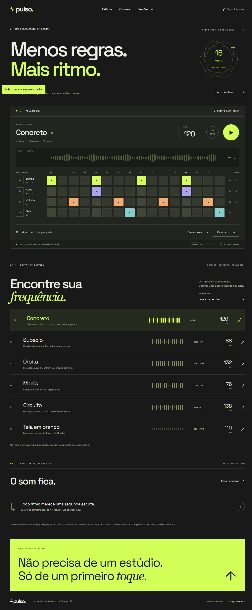

# Pulso

Um laboratório de ritmos no navegador. Desenhe uma batida em 16 passos, transforme grooves, ajuste o balanço e leve o resultado em WAV.

**[Abrir o estúdio →](https://gustapaz.github.io/pulso/)**



## Experiência

- Quatro instrumentos sintetizados localmente: bumbo, caixa, chimbal e tom.
- Sequenciador de 16 passos, reprodução com indicador de posição e prévia de cada instrumento.
- Tempo de 60 a 180 BPM e tap tempo; mixer com volume por pista, master, swing, mute e solo.
- Cinco grooves autorais e uma grade vazia, com filtro por estilo.
- Rascunho automático e biblioteca de até 30 sessões no dispositivo.
- Importação e exportação de projetos JSON com validação de esquema.
- Renderização real de WAV mono PCM de 16 bits a 44,1 kHz, em 1, 4, 8 ou 16 compassos.
- Guia de uso, confirmação antes de limpar ou excluir e feedback acessível.

Não precisa de cadastro, microfone ou conta em um serviço musical. Todas as bases são fixtures autorais; não há API, backend, banco remoto, autenticação real ou coleta de dados. O áudio é funcional e gerado pela Web Audio API no cliente, sem samples de terceiros.

## Direção visual

SolidJS foi escolhido para explorar atualização granular de uma superfície musical interativa. A direção combina cartaz tipográfico e mesa de som: controles circulares, grade contínua, fundo grafite, acento ácido e listas abertas em lugar de uma navegação lateral com cards. A composição mobile mantém os passos utilizáveis em uma região horizontal acessível.

[Decisões de composição e movimento](docs/design.md)

## Stack

SolidJS 1.9, TypeScript 6, Vite 8, Web Audio API, CSS responsivo e fontes variáveis hospedadas junto ao site. Hospedagem estática gratuita no GitHub Pages. Não exige cartão, trial ou faturamento.

## Rodar localmente

Node.js 24 ou superior.

```sh
npm ci
npm run dev
npm test
npm run build
npm run preview
```

O caminho base é `/pulso/`. O workflow do GitHub Actions executa instalação com lockfile, testes, verificação TypeScript, build e deploy de `dist/` no Pages. Se mudar o nome do repositório, ajuste a base no Vite e as URLs absolutas no HTML.

## Acessibilidade e desempenho

HTML semântico, nomes acessíveis nos passos, estado `aria-pressed`, controles nativos, foco visível, modal com contenção e retorno de foco, mensagens de status e respeito a `prefers-reduced-motion`. Não há scroll hijacking. A reprodução pausa quando a aba fica oculta. A animação de sinal é decorativa e indica reprodução; não é um analisador espectral.

As duas fontes são WOFF2 locais com `font-display: swap`. Não há imagens pesadas, bibliotecas de áudio ou chamadas externas em execução. A lógica temporal usa o relógio de áudio com agendamento antecipado; a interface acompanha por callbacks separados.

## Verificação e limites

Os testes de unidade cobrem presets independentes, importação inválida, mute/solo, duração do swing e cabeçalho/conversão PCM do WAV. [Registro das verificações](docs/validacao.md).

As sessões ficam no armazenamento deste navegador, sem sincronização entre dispositivos. Limpar os dados do site também apaga a biblioteca: exporte JSON para manter um backup. A duração máxima de exportação é 16 compassos; a saída inclui 0,5 segundo para a cauda dos sons. Use um navegador atual com Web Audio API e volume moderado. O projeto não faz gravação do microfone nem inclui reprodução contínua em segundo plano.

## Licença

Código e grooves: [MIT](LICENSE), Gustavo Paz. Fontes DM Sans e Space Grotesk sob SIL Open Font License; textos originais em [DM Sans](docs/LICENSE-DM-Sans.txt) e [Space Grotesk](docs/LICENSE-Space-Grotesk.txt). Dependências mantêm suas licenças próprias nos respectivos pacotes.
